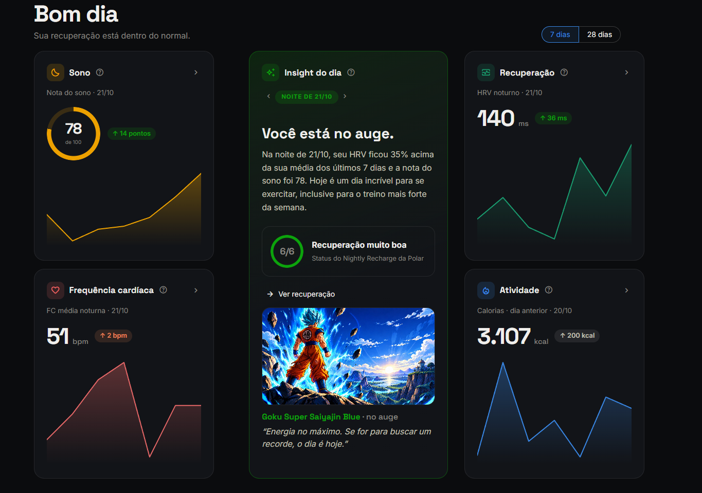
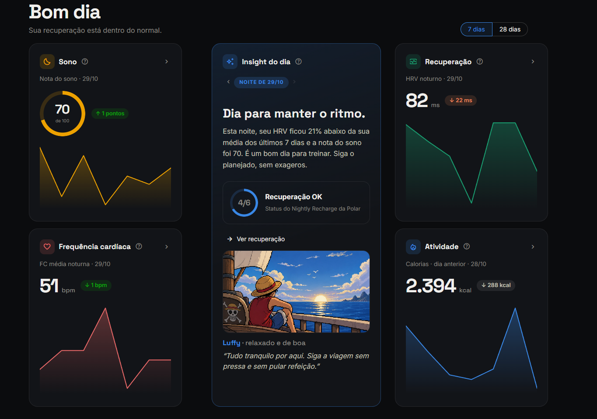
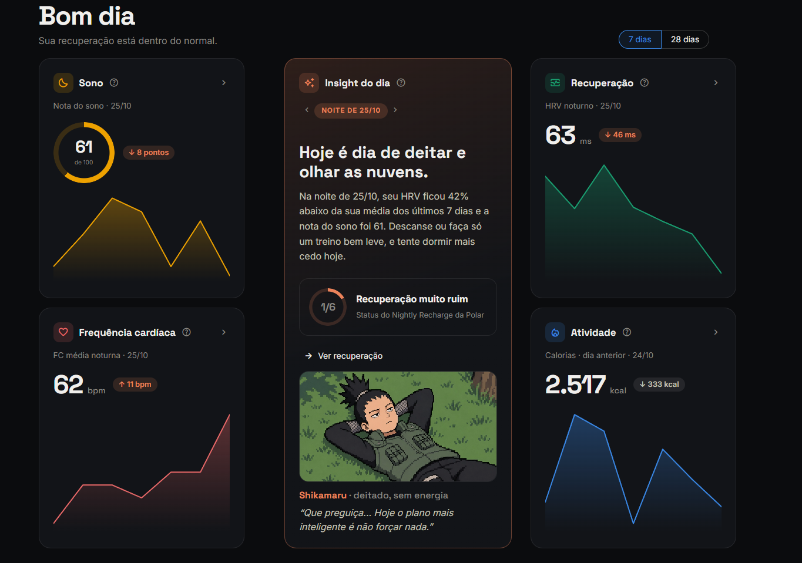

# Polar Loop Dashboard

Dashboard **local** em Python para acompanhar os dados de uma pulseira [Polar Loop](https://www.polar.com/): sono, recuperação noturna (Nightly Recharge / HRV), frequência cardíaca e atividade.

Os dados são baixados da [API Polar AccessLink v3](https://www.polar.com/accesslink-api/), guardados num banco SQLite no seu computador e exibidos num app [Streamlit](https://streamlit.io) com gráficos [plotly](https://plotly.com/python/). Nada é enviado a outro serviço.


> Projeto pessoal de estudo, sem afiliação com a Polar Electro.

## Telas

O **Insight do dia** muda com o status do Nightly Recharge. Cada um dos 6 níveis tem título, conselho, cor e personagem próprios, e as setas ‹ › navegam entre as noites:

| Recuperação muito boa (6/6) | Recuperação OK (4/6) | Recuperação muito ruim (1/6) |
|---|---|---|
|  
|  
|  |

## Funcionalidades

**Resumo**
- **Cartões dos quatro grupos:** cada cartão mostra o destaque do grupo (nota do sono, HRV, FC média noturna e calorias), uma pílula que compara com a média dos 7 registros anteriores e uma sparkline.
- **Insight do dia:** gerado por **regras locais**, sem IA, a partir do status do Nightly Recharge, do HRV e da nota do sono. Cada um dos 6 níveis de recuperação tem mensagem e personagem próprios.
- **Navegação entre noites:** as setas ‹ › mudam a noite mostrada no Insight, e os cartões acompanham.

**Páginas de detalhe**

| Página | O que mostra |
|---|---|
| **Sono** | Nota e duração, estágios por noite, hipnograma (Profundo, Leve, REM, Acordado) e FC durante o sono. |
| **Recuperação** | Status do Nightly Recharge, HRV, ANS charge, respiração e as medições da noite. |
| **Frequência cardíaca** | FC média noturna, mínima e máxima por dia e FC contínua ao longo do dia. |
| **Atividade** | Calorias (ativas e totais), passos, tempo ativo e alertas de inatividade. |

**Em todas as páginas**
- **Período:** 7 ou 28 dias, compartilhado entre as páginas.
- **Ajuda:** um "?" ao lado de cada gráfico e categoria explica o que é medido.
- **Visual:** tema escuro, uma cor por grupo e layout responsivo (desktop, tablet e celular).

## Como funciona

```
Polar Loop ──► app Polar Flow ──► API AccessLink ──► polar/sync.py ──► data/polar.db ──► dashboard (Streamlit)
                                     (OAuth2)          (últimos 28 dias)     (SQLite)
```

1. **Autorização (uma vez):** `polar/auth.py` faz o fluxo OAuth2 (authorization code). Ele abre o navegador, recebe o código num servidor local em `localhost:5000`, troca o código por um token e registra o usuário na API.
2. **Sincronização:** `polar/sync.py` baixa sono, Nightly Recharge, atividade diária e FC contínua e grava tudo no SQLite com *upsert* por data. Pode rodar quantas vezes quiser sem duplicar dados.
3. **Dashboard:** lê o banco e desenha as páginas. O botão **Sincronizar** no topo faz o passo 2 sem sair do app.

A API só devolve os **últimos 28 dias** de sono, Nightly Recharge e FC. Como o banco local acumula tudo, sincronizar com frequência forma um histórico mais longo.

## Instalação

Requer **Python 3.12** e uma conta Polar Flow com um Polar Loop. Os comandos abaixo são do PowerShell no Windows. No macOS e no Linux, troque `.\.venv\Scripts\python.exe` por `.venv/bin/python`.

**1. Clone o projeto e instale as dependências**
```powershell
git clone https://github.com/MateusPerazzo/polar-dashboard.git
cd polar-dashboard
python -m venv .venv
.\.venv\Scripts\python.exe -m pip install -r requirements.txt
```

**2. Crie um cliente na AccessLink**

Em [admin.polaraccesslink.com](https://admin.polaraccesslink.com), crie um cliente com:
- **Redirect URL:** `http://localhost:5000/callback`
- **Dados:** sono, Nightly Recharge, atividade diária e FC contínua.

**3. Configure as credenciais**

Copie `.env.example` para `.env` e preencha com os dados do cliente:
```
POLAR_CLIENT_ID=...
POLAR_CLIENT_SECRET=...
POLAR_REDIRECT_URI=http://localhost:5000/callback
```

**4. Autorize o acesso** (só na primeira vez)
```powershell
.\.venv\Scripts\python.exe -m polar.auth
```
O navegador abre a página da Polar. Depois de autorizar, aparece "Autorizado" e o token fica salvo em `data/token.json`. **Não feche o terminal** enquanto ele espera a resposta: um Ctrl+C interrompe o servidor local.

**5. Baixe os dados**
```powershell
.\.venv\Scripts\python.exe -m polar.sync
```

**6. Abra o dashboard**
```powershell
.\.venv\Scripts\python.exe -m streamlit run dashboard.py
```
O app abre em `http://localhost:8501`.

## Estrutura

```
dashboard.py        ponto de entrada: navegação, CSS global e barra do topo
polar/              dados (não depende do Streamlit)
  auth.py           OAuth2 com a Polar (roda uma vez)
  api.py            chamadas GET à AccessLink
  db.py             schema do SQLite e funções de gravação
  sync.py           baixa os dados e grava no banco
app/                interface
  ui.py             identidade visual: cores, CSS e componentes HTML
  charts.py         leitura do banco e gráficos plotly
  insights.py       regras do Insight do dia e tradução dos códigos da Polar
  views/            uma página por grupo (Resumo, Sono, Recuperação, FC, Atividade)
  assets/recharge/  imagens dos níveis do Nightly Recharge (1.png ... 6.png)
scripts/explore.py  diagnóstico: mostra só a estrutura das respostas da API
tests/              testes com dados fictícios
data/               banco, token e respostas brutas (fora do Git)
```

## Testes

```powershell
.\.venv\Scripts\python.exe -m unittest -v
```

Os testes usam `unittest` (biblioteca padrão) e **dados fictícios**. Eles cobrem as regras do Insight, a montagem do hipnograma e as conversões da sincronização, como os horários que cruzam a meia-noite e as durações ISO 8601. Não chamam a API nem leem o banco.

## Privacidade

- **Credenciais:** o client ID, o secret e o token ficam no `.env` e em `data/`, e os dois estão no `.gitignore`.
- **Dados de saúde:** ficam só em `data/polar.db`, no seu computador.
- **Sem serviços externos:** o Insight do dia usa regras locais e nada é enviado a serviços de terceiros. As únicas conexões externas são a API da Polar e as fontes do Google Fonts.

## Problemas comuns

| Sintoma | Causa e solução |
|---|---|
| `Faltando no .env: ...` ao autorizar | O `.env` não existe ou está incompleto. Copie o `.env.example` e preencha. |
| O navegador mostra "conexão recusada" em `localhost:5000` | O `polar.auth` foi interrompido antes da Polar redirecionar. Rode de novo e não mexa no terminal enquanto ele espera. |
| As páginas pedem para sincronizar | O banco está vazio. Rode `python -m polar.sync` ou clique em **Sincronizar**. |
| Erro 401 na sincronização | O token expirou ou foi revogado. Rode o `polar.auth` de novo. |
| Mudanças em `app/` ou `polar/` não aparecem | O Streamlit guarda os módulos na memória. Reinicie com Ctrl+C e rode o comando de novo. |

## Créditos

- **Dados:** API Polar AccessLink. Polar, Polar Loop, Polar Flow e Nightly Recharge são marcas da Polar Electro Oy.
- **Imagens dos níveis:** as imagens em `app/assets/recharge/` mostram personagens de anime (Naruto, One Piece, Dragon Ball e outros), que pertencem aos respectivos autores e estúdios. Elas são usadas aqui sem fins comerciais, como homenagem, e podem ser removidas a pedido.
